# PeopleData - Aplikasi CRUD Data Civitas Kampus dengan Database MySQL (Java Swing)

Aplikasi desktop berbasis **Java Swing GUI** untuk mengelola data orang
(civitas kampus) dengan operasi **Create, Read, Update, dan Delete**.
Berbeda dari versi sebelumnya yang menyimpan data di memori, seluruh data
sekarang disimpan di **database MySQL** dan diakses lewat **JDBC**, sehingga
data tetap ada walau program ditutup.

---

---

## Janji
> Saya Ahmad Jadzil Rizki dengan NIM 2501839 mengerjakan TP5 dalam
> mata kuliah Desain Pemrograman Berorientasi Objek untuk keberkahanNya maka saya tidak
> melakukan kecurangan seperti yang telah dispesifikasikan. Aamiin.

---

## Persiapan Menjalankan

1. **Jalankan MySQL** lewat XAMPP atau Laragon.
2. **Import database.** Import file `db_people.sql` (phpMyAdmin → tab
   *Import*). File ini membuat database `db_people`, tabel `person`, dan
   8 data awal.
3. **Siapkan MySQL Connector.** Download *mysql-connector-j*
   (Platform Independent, `.zip`), ekstrak, lalu copy file
   `mysql-connector-j-....jar` ke folder `PeopleData/lib`.
4. **Daftarkan connector di IntelliJ.** *File → Project Structure →
   Modules → Dependencies → `+` → JARs or Directories*, pilih file `.jar`
   di folder `lib`, lalu *Apply* dan *OK*.
5. **Cek pengaturan koneksi** di bagian atas `Database.java`
   (`DB_URL`, `DB_USER`, `DB_PASSWORD`). Nilai bawaannya cocok untuk
   XAMPP/Laragon: user `root` dan password kosong.
6. Buka `PeopleMenu.java`, lalu klik **Run 'PeopleMenu.main()'**.

---

## Desain Program

### Pembagian tugas

| File | Peran |
|---|---|
| `Person.java` | Model data: membawa data satu orang (id, nama, tahun lahir, kategori, keaktifan) |
| `Database.java` | Menangani koneksi dan eksekusi query ke MySQL |
| `PeopleMenu.java` | Logika GUI: validasi input, memanggil query, dan memperbarui tabel |
| `PeopleMenu.form` | Desain tampilan (layout dan component) |
| `db_people.sql` | Skema database dan data awal |

Alurnya berlapis: tampilan (`PeopleMenu`) tidak berbicara langsung ke
MySQL, melainkan lewat class `Database`. Jika pengaturan koneksi berubah,
cukup satu file yang disesuaikan.

### Struktur database

Database `db_people`, tabel `person`:

| Kolom | Tipe | Keterangan |
|---|---|---|
| `id` | VARCHAR(20) | **Primary key**, identitas unik |
| `nama` | VARCHAR(100) | Nama lengkap |
| `tahun_lahir` | INT | Tahun lahir |
| `kategori` | VARCHAR(50) | Mahasiswa / Dosen / Tenaga Kependidikan / Asisten Praktikum / Alumni |
| `keaktifan` | INT | Tingkat keaktifan 0-100 (atribut tambahan, diisi lewat `JSlider`) |

### Class `Database`

| Method | Fungsi |
|---|---|
| `Database()` | Membuka koneksi ke MySQL; melempar `SQLException` jika gagal |
| `selectQuery(sql, params...)` | Menjalankan `SELECT` dan mengembalikan `ResultSet` |
| `insertUpdateDeleteQuery(sql, params...)` | Menjalankan `INSERT` / `UPDATE` / `DELETE`, mengembalikan jumlah baris yang berubah |
| `close()` | Menutup koneksi saat program berakhir |

Query dijalankan dengan `PreparedStatement`: nilai dari form dikirim sebagai
parameter (`?`), bukan disambung ke teks SQL. Dengan begitu nama yang
mengandung tanda petik tidak merusak query, dan program aman dari SQL
injection.

### Method pada `PeopleMenu`

| Method | Fungsi |
|---|---|
| `main()` | Membuat window, mengatur ukuran dan posisinya, lalu menampilkannya |
| `PeopleMenu()` | Constructor: membuka koneksi database, mengisi tabel dan combo box, memasang listener |
| `setTable()` | Menjalankan `SELECT` dan membuat model tabel langsung dari hasilnya |
| `ambilDataForm()` | Membaca dan memvalidasi form, menghasilkan object `Person` (atau `null` jika tidak valid) |
| `idSudahAda()` | Mengecek ke database apakah sebuah ID sudah dipakai |
| `insertData()` | **Create** - menjalankan `INSERT` |
| `updateData()` | **Update** - menjalankan `UPDATE` |
| `deleteData()` | **Delete** - menjalankan `DELETE` setelah konfirmasi |
| `clearForm()` | Mengosongkan form dan kembali ke mode tambah |

### Query yang digunakan

| Operasi | Query |
|---|---|
| Read (isi tabel) | `SELECT id, nama, tahun_lahir, kategori, keaktifan FROM person ORDER BY id` |
| Cek ID duplikat | `SELECT COUNT(*) FROM person WHERE id = ?` |
| Create | `INSERT INTO person (id, nama, tahun_lahir, kategori, keaktifan) VALUES (?, ?, ?, ?, ?)` |
| Update | `UPDATE person SET nama = ?, tahun_lahir = ?, kategori = ?, keaktifan = ? WHERE id = ?` |
| Delete | `DELETE FROM person WHERE id = ?` |

### Perubahan dari versi sebelumnya

1. **Seluruh CRUD memakai database.** Tidak ada lagi data awal yang ditulis
   di kode; data awal berasal dari `db_people.sql`.
2. **Tidak ada lagi list di memori.** Tabel diisi langsung dari hasil
   query. Saat sebuah baris diklik, nilainya dibaca langsung dari model
   tabel (`getValueAt`) untuk mengisi form.
3. **Kunci data adalah `id`.** Variabel `selectedId` menyimpan ID baris yang
   dipilih dan dipakai pada `UPDATE` dan `DELETE`. Karena itu kolom ID
   dikunci (tidak bisa diedit) saat mode ubah.
4. **Dialog error baru** untuk kolom kosong dan ID duplikat (lihat bawah).

### Dua mode tampilan: tambah dan ubah

| Kondisi | `selectedId` | Teks tombol | Tombol Delete | Kolom ID |
|---|---|---|---|---|
| Mode tambah (awal / setelah clear) | `null` | **Add** | Tersembunyi | Bisa diisi |
| Mode ubah (baris dipilih) | ID baris | **Update** | Tampil | Terkunci |

### Dialog dan prompt

| Dialog | Muncul saat | Judul |
|---|---|---|
| Kolom kosong | Add atau Update ditekan dan ada kolom yang belum diisi (pesan menyebutkan kolom mana saja) | Input Kosong |
| ID duplikat | Add ditekan dengan ID yang sudah ada di database | ID Duplikat |
| Tahun lahir bukan angka | Kolom Tahun Lahir berisi selain angka | Input Tidak Valid |
| Tahun lahir di luar rentang | Tahun lahir kurang dari 1900 atau lebih dari tahun sekarang | Input Tidak Valid |
| Konfirmasi hapus | Delete ditekan (pilihan Yes / No) | Konfirmasi Hapus |
| Koneksi gagal | Program dibuka saat MySQL mati atau connector belum terpasang | Koneksi Database Gagal |
| Error database | Operasi database gagal saat program berjalan (mis. MySQL dimatikan) | Error Database |

Kategori yang masih `???` dihitung sebagai kolom kosong.

---

## Penjelasan Alur Program

1. **Program dijalankan.** Constructor `PeopleMenu()` membuat object
   `Database` dan membuka koneksi ke MySQL. Jika gagal, muncul dialog
   *Koneksi Database Gagal* dan program berhenti. Jika berhasil, `setTable()`
   menjalankan `SELECT` dan hasilnya langsung dimasukkan ke tabel. Window
   tampil dalam mode tambah.

2. **Create (tambah data).**
   - User mengisi form lalu menekan **Add**, sehingga `insertData()` dipanggil.
   - `ambilDataForm(true)` memeriksa kolom kosong, format dan rentang
     tahun lahir, lalu mengecek ke database apakah ID sudah ada.
   - Jika ada yang tidak valid, dialog error muncul dan tidak ada data yang
     disimpan.
   - Jika valid, `INSERT` dijalankan, tabel diisi ulang dari database,
     form dikosongkan, dan muncul pesan *"Data berhasil ditambahkan!"*.

3. **Read (lihat data).**
   - Isi tabel selalu berasal dari hasil `SELECT`.
   - Saat user mengklik sebuah baris, nilai baris itu dibaca dari model
     tabel dan disalin ke form. `selectedId` diisi, tombol **Add** berubah
     menjadi **Update**, tombol **Delete** muncul, dan kolom ID dikunci.

4. **Update (ubah data).**
   - Setelah baris dipilih, user mengubah form lalu menekan **Update**.
   - `ambilDataForm(false)` memvalidasi input (pengecekan ID duplikat tidak
     diperlukan karena ID tidak berubah).
   - Jika valid, `UPDATE ... WHERE id = ?` dijalankan, tabel diisi ulang,
     form dikosongkan, dan muncul pesan *"Data berhasil diubah!"*.

5. **Delete (hapus data).**
   - Setelah baris dipilih, user menekan **Delete** dan muncul dialog
     konfirmasi.
   - Jika memilih **Yes**, `DELETE ... WHERE id = ?` dijalankan, tabel diisi
     ulang, dan muncul pesan *"Data berhasil dihapus!"*.
   - Jika memilih **No**, tidak ada yang berubah.

6. **Cancel.** Kapan saja user dapat menekan **Cancel** untuk mengosongkan
   form, membatalkan pilihan baris, dan kembali ke mode tambah.

7. **Program ditutup.** Koneksi database ditutup lewat `Database.close()`.

---

## Struktur Folder

```
TP5DPBO2526C2/
├── PeopleData/
│   ├── lib/
│   │   └── mysql-connector-j-x.x.x.jar
│   └── src/
│       ├── Person.java
│       ├── Database.java
│       ├── PeopleMenu.java
│       └── PeopleMenu.form
├── Dokumentasi/
│   └── (screenshot program berjalan)
├── db_people.sql
└── README.md
```

---

## Dokumentasi

Seluruh operasi CRUD dan semua dialog error didokumentasikan di bawah ini.

### Tampilan awal (Read)

Tabel terisi dari database saat program pertama dijalankan.

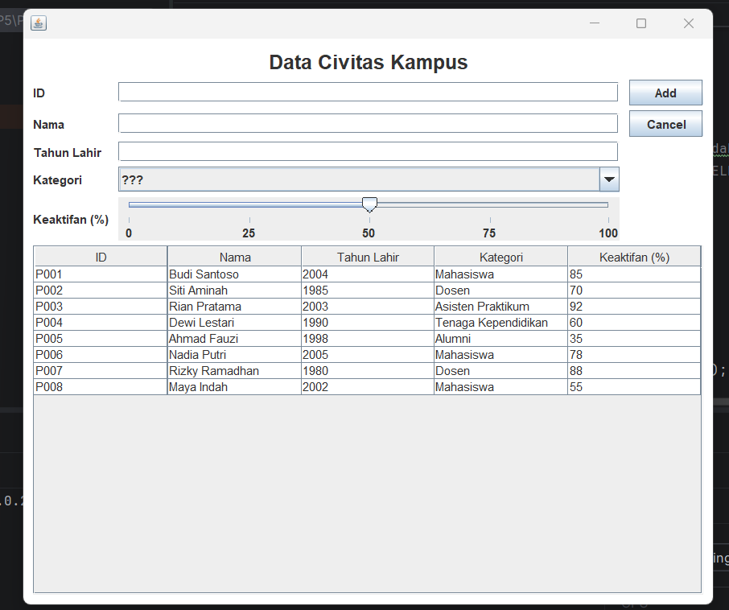

### Create - menambah data

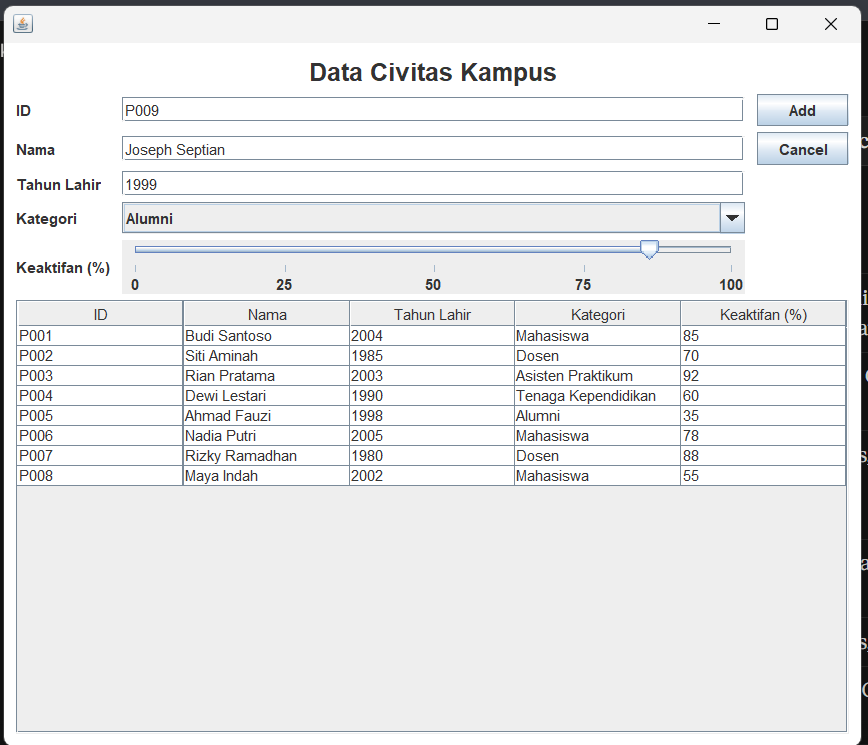
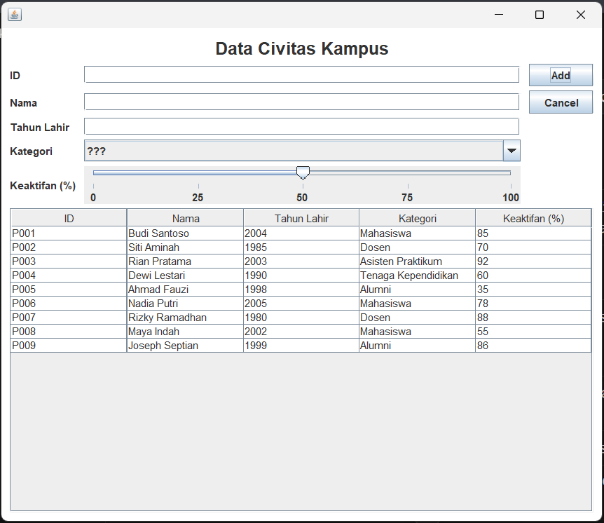

### Update - mengubah data

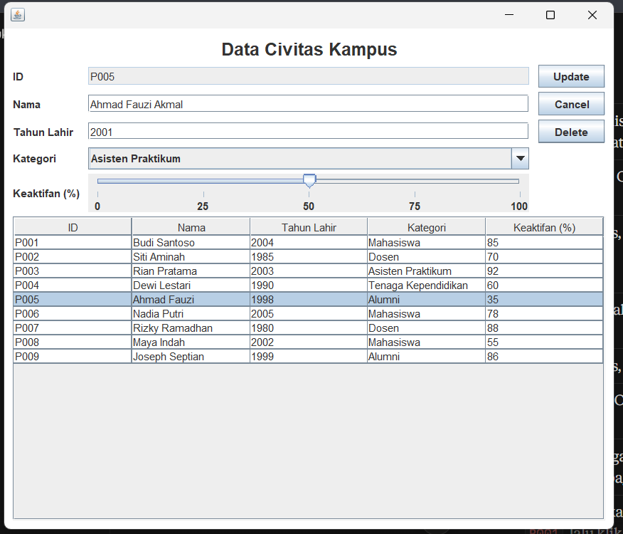
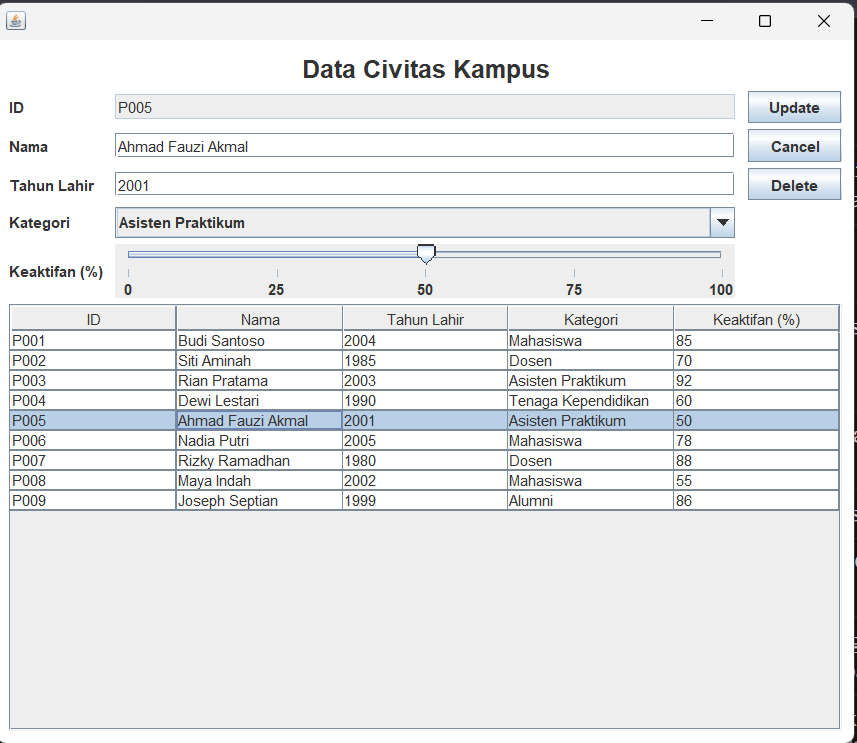

### Delete - menghapus data (dengan konfirmasi)

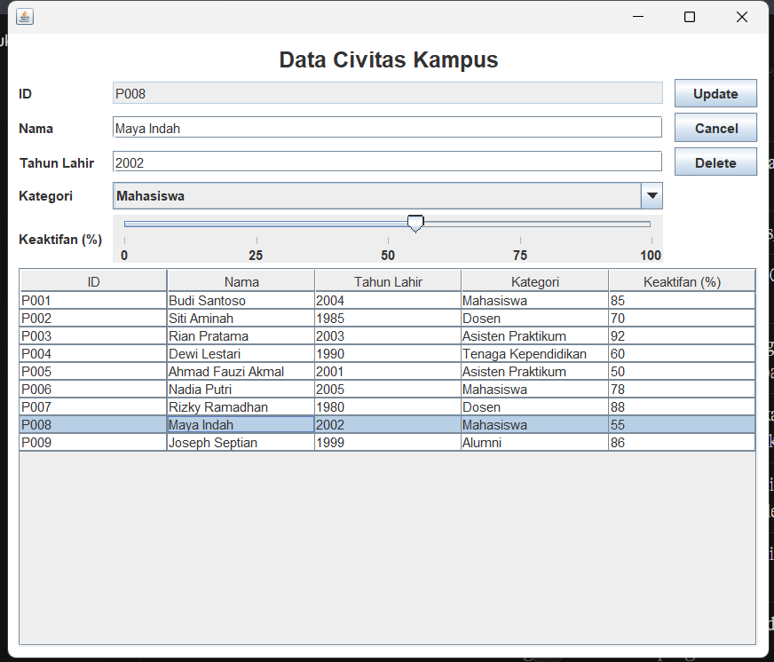
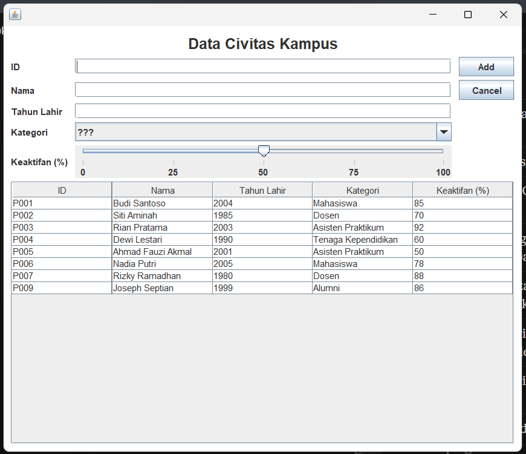

### Dialog error

Dialog saat ada kolom yang masih kosong:

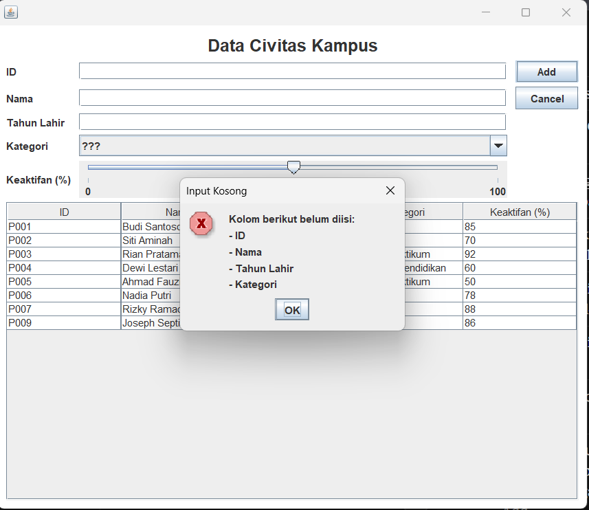

Dialog saat ID yang dimasukkan sudah ada:

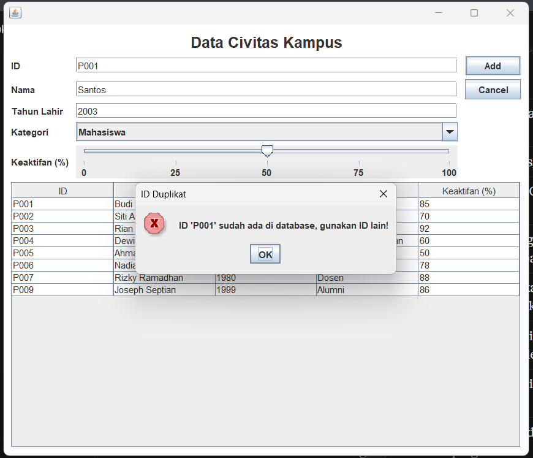

Dialog saat tahun lahir bukan angka dan saat di luar rentang:

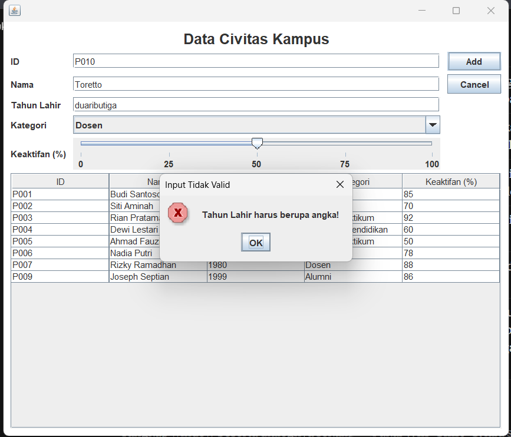
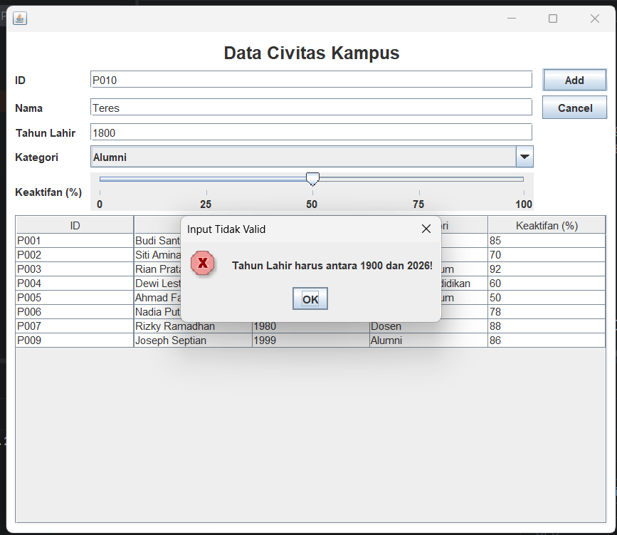

Dialog saat koneksi database gagal dan saat operasi database gagal:

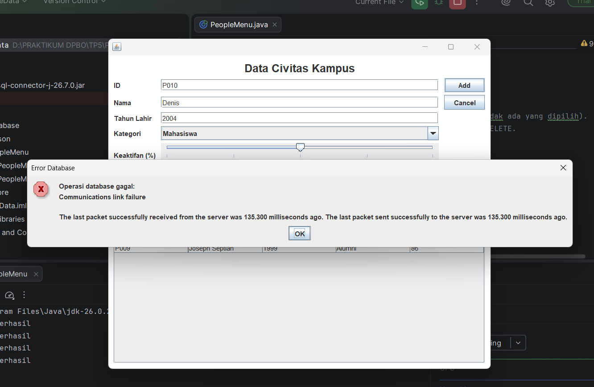
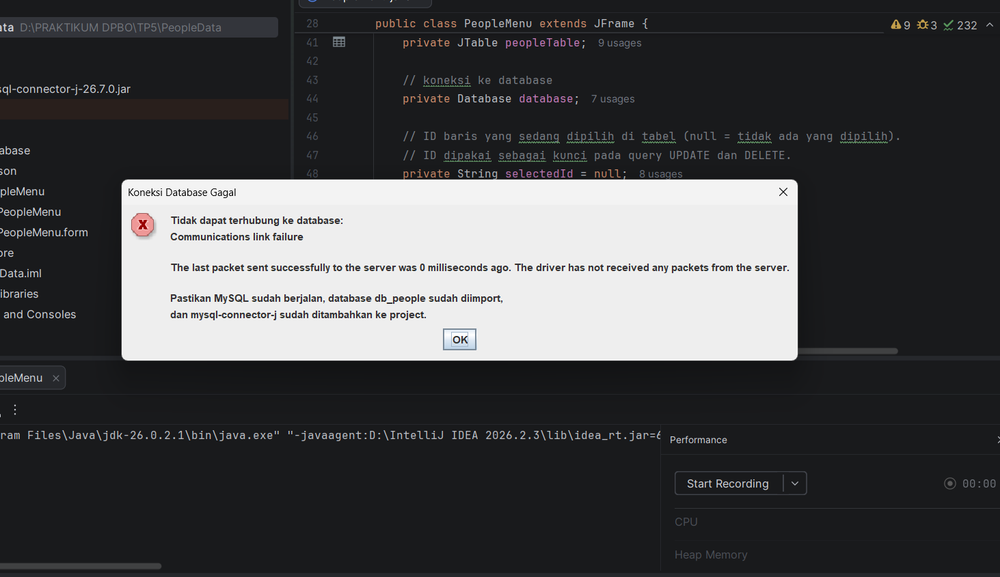
